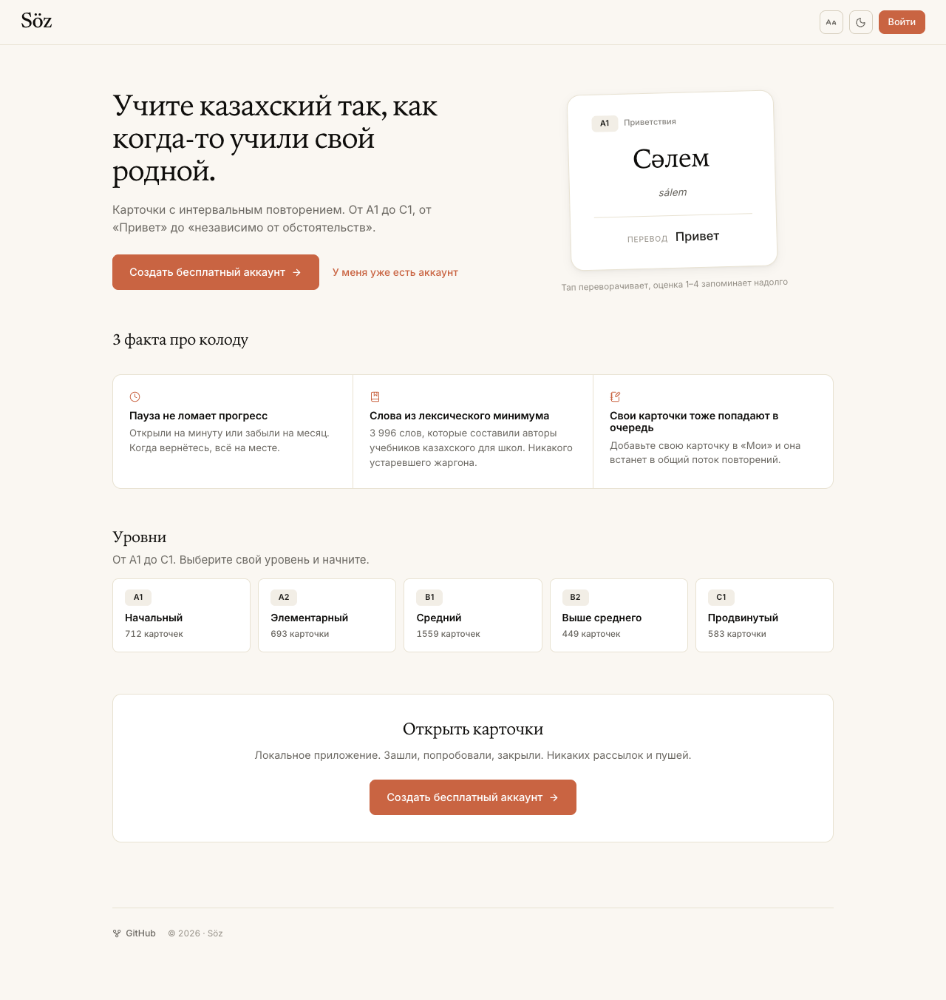
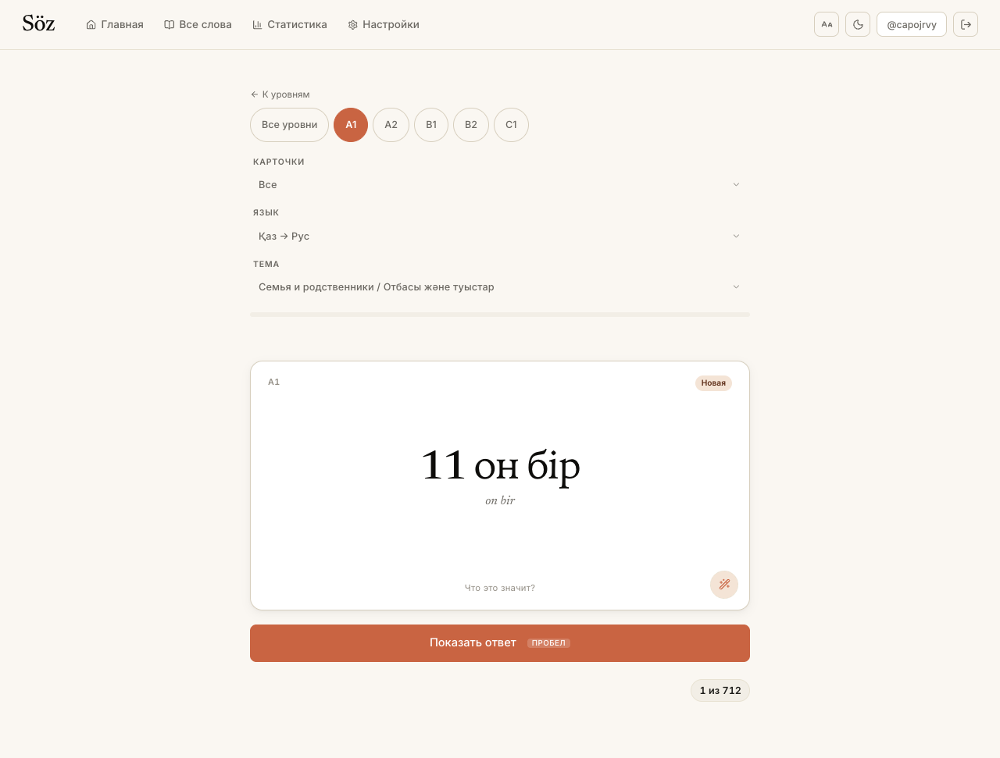
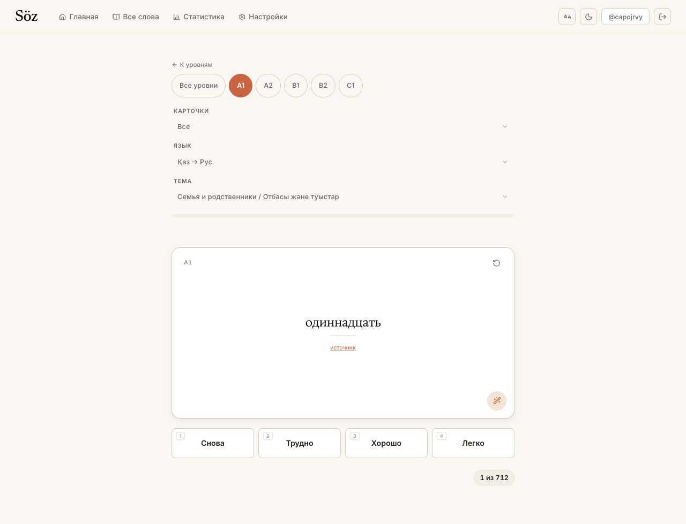
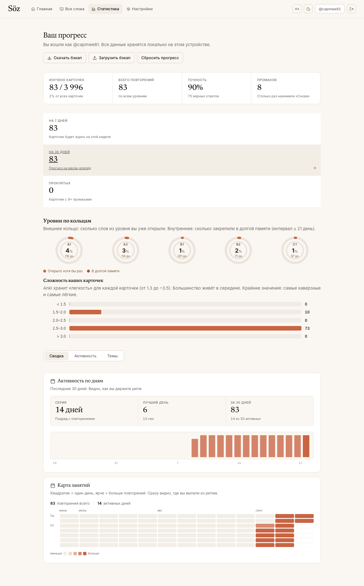

# Қазақ Anki — Spaced-Repetition Flashcards for Kazakh

A self-hosted web app for learning Қазақ тілі with Anki-style spaced repetition. 3,996 words across the five CEFR levels A1 to C1, each card carrying the Kazakh word, a transliteration, the Russian translation and a recording in two voices.



[](#license)
[](https://github.com/aa-blinov/qazaq-anki/actions/workflows/ci.yml)

---

## Quick start

```bash
git clone https://github.com/aa-blinov/qazaq-anki.git
cd qazaq-anki
docker compose up -d --build qazaq-api qazaq-web qazaq-tts-service
```

Open <http://localhost:8080>, register an account and start studying. Three containers are enough: the Express API, nginx serving the built bundle on port 8080, and the Piper service that synthesises the words with no pre-generated clip. Only nginx publishes a port; the other two stay on the internal network.

The fourth service, the hourly backup, mounts a Docker secret and will not start without it, so the full stack needs one more file:

```bash
mkdir -p secrets
openssl rand -hex 32 > secrets/admin_token.txt
printf 'ADMIN_TOKEN=%s\n' "$(cat secrets/admin_token.txt)" > .env
docker compose up -d --build
```

The token has to reach the API as well, because the admin routes that the backup job calls answer 404 while `ADMIN_TOKEN` is unset. Without the `.env` line the other three services still come up and the app works; the backup container restarts in a loop and says why in its log.

Caddy and TLS join in with the `prod` profile, and the deployment steps for that live in [DEPLOY.md](DEPLOY.md).

Without Docker, two processes on Node 22:

```bash
npm ci
npm run server   # API on http://localhost:3001
npm run dev      # app on http://localhost:5173
```

The dev server proxies `/api/*` to port 3001, so there is nothing to configure. The API is needed in both cases: accounts, progress and statistics live on the server, so the front end on its own cannot register anyone.

| What you want | Command | Where it lands |
| --- | --- | --- |
| The app over HTTP | `docker compose up -d --build qazaq-api qazaq-web qazaq-tts-service` | <http://localhost:8080> |
| The whole stack over HTTP | `docker compose up -d --build` | <http://localhost:8080> |
| The whole stack behind TLS | `docker compose --profile prod up -d --build` | your own domain, port 443 |
| The API alone | `npm run server` | <http://localhost:3001> |
| The front end alone | `npm run dev` | <http://localhost:5173> |
| The production bundle | `npm run build && npm run preview` | <http://localhost:4173> |

## What it does

- **3,996 Kazakh words across five CEFR decks.** 712 in A1, 693 in A2, 1,559 in B1, 449 in B2 and 583 in C1, grouped into 34 topics. Every card carries the Kazakh word, a transliteration, the Russian translation and a link to the source lexicon it came from.
- **Spaced repetition with the SM-2 algorithm.** Four grades (Again, Hard, Good, Easy) on the keyboard as `1` to `4`, and the Anki scheduler defaults: learning steps of 1 and 10 minutes, a 1 day graduating interval, a 4 day easy interval, ease starting at 2.5 and never dropping below 1.3, intervals capped at 36,500 days, and a 5 percent jitter seeded by card id so the same card always lands on the same date.
- **An account per learner, on your own disk.** Passwords are bcrypt hashes with 10 rounds in the `users` table of a SQLite file whose path you chose. The browser keeps four localStorage keys and nothing else: `aq:token`, `aq:theme`, `aq:fontSize`, `aq:ttsSpeed`.
- **A daily queue instead of a backlog.** 20 new cards and 50 reviews a day by default, both adjustable in Settings. A card that lapses eight times becomes a leech, and the Stats page can reset every leech in one action.
- **Pronunciation for every word.** 7,473 lossless FLAC clips, 168 MB in total, in two Piper voices: `kk_KZ-issai-high` for Kazakh and `ru_RU-denis-medium` for Russian. A word with no clip is synthesised on demand and written beside the pre-generated ones, in the same format.
- **Statistics about learning rather than activity.** Mastery rings per CEFR level, an ease histogram, day-to-day retention, a 13-week activity heatmap on the Stats page and a 7-week one on the home page, per-topic progress and a days-to-mastery forecast.
- **Browse, filter and add.** Search all 3,996 cards, filter by level and topic, and add your own cards with the Kazakh word, the translation and an example sentence.
- **Anki import and a plain JSON backup.** Upload an `.apkg` archive, or download a JSON file with your progress and review log and load it back on another machine.
- **A Russian interface around Kazakh content.** Every label, button, error message and empty state is in Russian. The Kazakh word is the only Kazakh surface in the product.

## Screenshots

| The landing page | The card, front |
| :---: | :---: |
|  |  |

| The card, back | The statistics page |
| :---: | :---: |
|  |  |

Every route at desktop and mobile size, plus the dark theme, is in [docs/screenshots/](docs/screenshots/README.md). The images are produced by `scripts/capture-ui.mjs`, which boots the API and a preview build, registers two throwaway accounts and writes into `docs/screenshots/`.

## How it works

```
browser (React 19 SPA)
  |
  |  /api/*  (same origin, nginx reverse proxy)
  v
Express API (server.js)  ---->  SQLite file via sql.js (qazaq.sqlite)
  |
  |  POST /api/tts/synthesize
  v
Piper TTS service (:8000)  ---->  public/audio/<lang>/<hash>.flac
```

The front end is a React 19 SPA built by Vite 6. The API is a separate Express process on Node 22 that owns the SQLite file through sql.js, so the whole database lives in one file that you can copy, back up or delete. nginx serves the built bundle and proxies `/api/*` to the API, which keeps the browser on one origin and leaves CORS out of the picture.

| Module | What it holds |
| --- | --- |
| `src/data/decks.json` | The manifest: five levels, their tier, their topics and the card count. |
| `src/data/decks/{a1..c1}.json` | The cards themselves, one file per level. |
| `src/data/decks.ts` | The `Card` type and `loadLevel()`, which imports a level lazily so Vite splits the bundle per deck. |
| `src/lib/sm2.ts` | The scheduler: card phases, the four grades, the fuzz, the migration from the old state shape. |
| `src/lib/api.ts` | The only module that talks to the server. |
| `src/lib/storage.ts` | The localStorage wrapper, with an in-memory fallback for private mode. |
| `src/lib/tts.ts` | The audio URL builder and the per-language manifest loader. |
| `src/contexts/` | Auth, progress, theme, font size, language, onboarding and user cards. |
| `src/pages/` | Home, Login, Register, Study, Browse, Stats, Settings. |
| `server.js` | The API: 34 routes under `/api`. |
| `auth.js` | Registration, login, sessions, password change and recovery. |
| `db.js` | The sql.js database, the schema and the migrations that run on boot. |
| `cards.js` | The user-added cards. |
| `apkg.js` | Anki package import and export. |
| `deck-meta.js` | The card id to level map the server builds at boot for the per-level statistics. |
| `ratelimit.js` | The in-memory fixed-window limiter. |

Authentication is server-side throughout. The API hashes a password with bcrypt, stores the hash in the `users` table and never hands it back. Registering or logging in mints an opaque session token, stores it in the `sessions` table and returns it; the client sends it as `Authorization: Bearer <token>` on every request. The token is the one piece of session state the browser persists.

Progress is not in the browser at all. `ProgressContext` reads it from `/api/progress` on load and writes it back through the review endpoints, so clearing site data costs a re-login rather than a history.

The audio is fetched one word at a time. A per-language manifest lists the SHA-1 hashes of the words that have a clip; the speak button appears once the manifest for that language has arrived, and the clip itself is a static file served by nginx with a one-year immutable cache header.

## Configuration

Every setting has a working default, so the stack runs with no configuration at all. These are the variables worth knowing about:

| Variable | Default | What it does |
| --- | --- | --- |
| `PORT` | `3001` | The port the API listens on. |
| `HOST` | `0.0.0.0` | The address the API binds to. |
| `DB_PATH` | `data/qazaq.sqlite` under the working directory, `/data/qazaq.sqlite` in the container | Where the SQLite file lives. The directory is created on boot. |
| `CORS_ORIGIN` | any origin; `http://localhost:8080` in Docker | Comma-separated list of allowed origins. |
| `ADMIN_TOKEN` | none | The shared secret for `/api/admin/checkpoint` and `/api/admin/backup-now`. Unset means both routes answer 404. |
| `RATE_LIMIT_REGISTER` | `5` | Registrations per 10 minutes per IP. |
| `RATE_LIMIT_LOGIN` | `10` | Logins per 5 minutes per IP. |
| `VITE_BASE` | `/` in dev, `/qazaq-anki/` in a production build | The path the built assets are served from. |
| `VITE_API_URL` | empty | The API base URL, for a front end served without the nginx proxy. |
| `CADDY_DOMAIN` | none | The domain Caddy issues a certificate for. Required by the `prod` profile. |
| `CADDY_EMAIL` | none | The Let's Encrypt registration address. |
| `BACKUP_CRON` | `0 * * * *` | When the backup container takes a snapshot. `off` runs once and exits. |
| `KEEP_LOCAL` | `24` | How many snapshots stay on disk. |
| `TTS_MODELS_DIR` | `/models` | Where the Piper voice models are kept between restarts. |

Two templates ship with the repository: `.env.example` for a plain run and `.env.production.example` for the `prod` profile. The learner-facing settings live in the app itself, in Settings: daily new-card cap, daily review goal, leech threshold, pronunciation speed, interface text size in four steps, and the light or dark theme.

## Development

```bash
npm ci              # install
npm run server      # the API on :3001, restarting on change
npm run dev         # the front end on :5173
npm test            # the unit tests, 11 files
npm run e2e         # the Playwright suite, 18 spec files
npm run build       # typecheck, build, then write the SPA fallback config
npm run build:quick # the build alone, without the typecheck
npm run preview     # serve the built bundle
npm run deploy      # publish landing/ to the gh-pages branch
npm run deploy:app  # build for /qazaq-anki/ and publish dist/
```

`npm test` runs Vitest over `src/**/*.test.ts` in a jsdom environment. `npm run e2e` boots its own API on port 3011 with its own SQLite file and its own Vite on port 5174, so the dev API and the dev database are never touched.

| Path | What it holds |
| --- | --- |
| `src/` | The React front end. |
| `server.js`, `auth.js`, `db.js`, `cards.js`, `apkg.js`, `deck-meta.js`, `ratelimit.js` | The API, plain ESM with no build step. |
| `src/data/` | The decks, the manifest and the provenance registry. |
| `e2e/` | The Playwright specs. |
| `scripts/` | The deck parser, the topic unifier, the TTS generator and the screenshot capture. |
| `landing/` | The static landing page published to GitHub Pages, in Russian and English. |
| `docker-compose.yml` | The five services and the volumes behind them. |
| `server/`, `web/`, `tts/`, `caddy/`, `backup/` | The container images. |
| `docs/` | The card data guide, the security audit, the user stories and the screenshots. |
| `DESIGN.md` | The visual system: tokens, typography, components. |

The vocabulary is regenerated, never hand-edited. The cards were parsed from the Qazcorpus school lexicon PDFs:

```bash
node scripts/build-lexmin.mjs /tmp/lexmin   # the parser, over the five PDFs
node scripts/unify-topics.mjs                # topics, de-duplication, id renumbering
npm test                                     # decks.test.ts pins the counts
```

Per-card provenance and licensing live in [src/data/SOURCES.md](src/data/SOURCES.md).

## License

MIT. Use it, fork it, build something on it; do not claim you made it. The repository carries no `LICENSE` file yet, so this paragraph is the only statement of the terms.

The vocabulary comes from the [Qazcorpus school lexicon](https://qazcorpus.kz/_oqu-ishorpus/Sauattik/), used under CC-BY-4.0, with attribution recorded per card in [src/data/SOURCES.md](src/data/SOURCES.md). The scheduler is the SM-2 algorithm by Wozniak, 1990.
